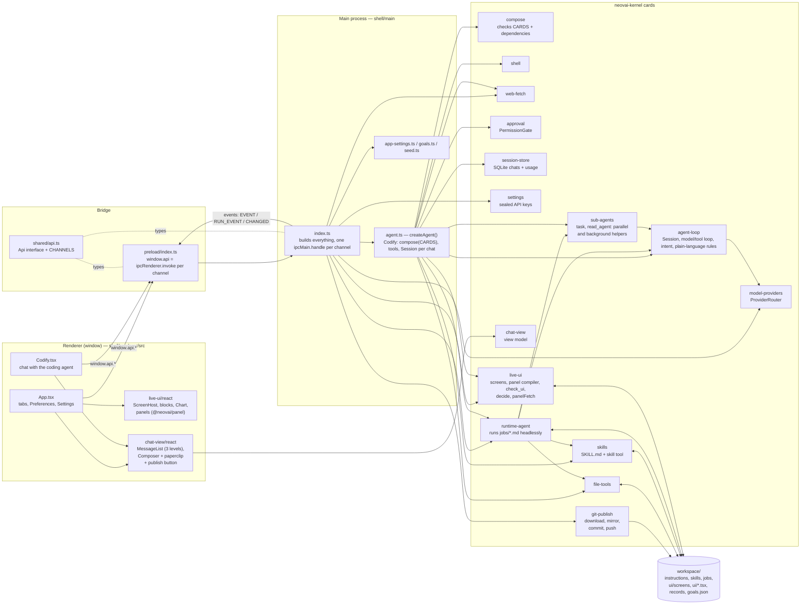
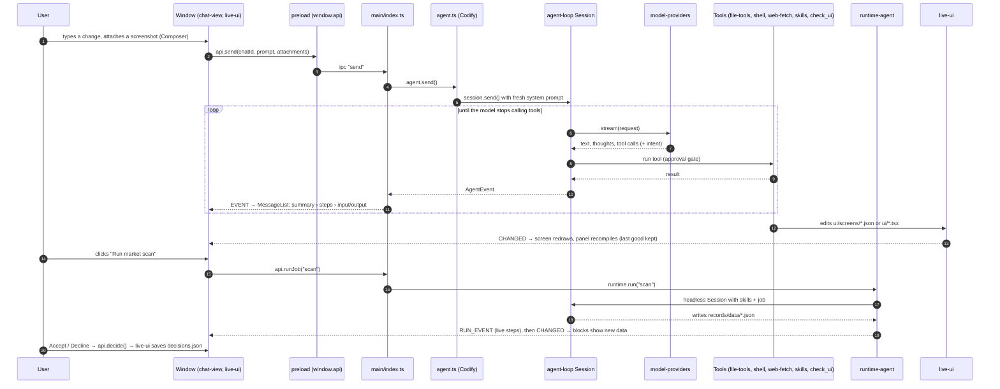
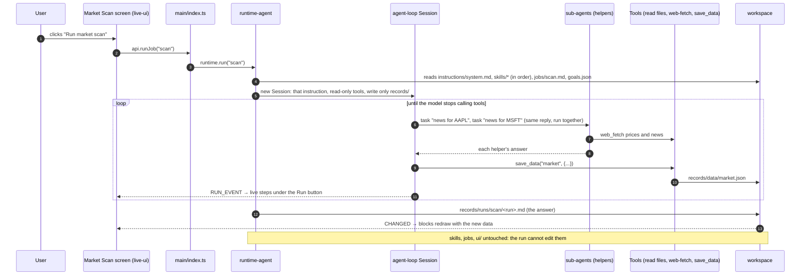
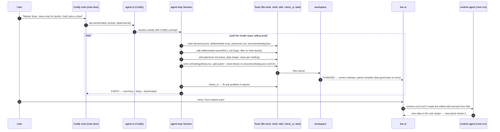

# Neovai Investor

A desktop app that recommends stocks and improves itself over time. It carries a
small agent harness (the [Neovai kernel](https://github.com/careychou/neovai-kernel))
next to its own logic and screens, so the agent can change the app's
skills, logic and UI from your feedback.

Not financial advice. The app never places trades or logs in to a brokerage.

## Status

Version 0.14.0. New in 0.14.0: a **Skills** page in the left menu lists every skill the app uses, grouped by where it lives: this app's workspace skills (read and edit them here, or have Codify change them) and shared skills from the project's `.github/skills` and your `~/.copilot/skills` (read-only; both agents can load them by name). Codify's second column is now session history only, and each request can be renamed (pencil or double-click). Both come from kernel v0.14.0 (`SessionList`, `SkillList`, `loadSkillSources`). In 0.13.0: publish goes straight to the remote repository (Settings › Publish › Repository, e.g. `git@github.com:you/neovai-investor.git`): it downloads the repository into a temporary folder, copies the workspace in, commits, pushes and deletes the folder, so no local working copy is needed (a local folder still works). In 0.12.0: a publish button next to the paperclip in Codify. One click copies the app's workspace into this repository's `workspace/` folder (leaving out run records and your preferences), commits and pushes, and the chat shows each step as it happens. In 0.11.0: Codify and the Main App's runtime agent can hand independent parts of a request to helper agents that run at the same time (for example one per stock); each helper shows as a step you can open to see its own work, nested in the chat, and Codify's helpers can run in the background and report back when done. In 0.10.0: every chat (Codify and run activity) shows tool steps in three levels, a one-line summary, then the steps in plain words, then each step's input and output, and the attach button is a paperclip. In 0.9.0: panels can draw trading-style charts (`chart` block or `<Chart>`: candlesticks, line, area, bars, volume, last-price tag, hover O/H/L/C), fetch live data through the main process (`useFetch`, `fetchJson`), import plain `.css` files and split into many files; Market Scan ships a live symbol chart (`ui/SymbolChart.tsx`) that Codify built. The app has two halves:

- **Main App**: one tab per skill, each with its own job: Preferences
  (user-preference, first tab: the user's budget, limits and trading rules, saved to
  `goals.json`; Settings no longer has a Goals form), Market Scan (market-scan),
  Candidates (candidate-evaluation), Recommendations (recommendation: new stocks,
  sells and changes, with Refresh) and Performance (performance-review: outcomes and
  open positions). Each tab has "Change this
  screen" and a button per skill it is built on, which open Codify on it.
  A tab is a screen in `workspace/ui/screens/*.json`. A screen is a
  list of built-in blocks (metrics, tables, alerts, recommendations, run buttons,
  reports, markdown) that read data from `workspace/records/data/`. When no block
  fits, a `panel` block shows a React `.tsx` file from `workspace/ui/`, compiled
  while the app runs. A broken file keeps showing its last working version.
  Panels are interactive: from `@neovai/panel` they can start jobs with options
  (`run(job, {mode: ...})`), stop them and follow their progress, Accept or Decline
  calls, read and save the user's preferences (`prefs`, `savePrefs`), keep their
  own choices across restarts (`usePanelState`), draw any
  built-in block inside themselves, and open Codify. They may also import
  `recharts`, `lucide-react` and `date-fns`. A `run` block can carry options too
  (`"input": {...}`); the runtime agent gets them with the run.
- **Run buttons** start jobs (`workspace/jobs/*.md`) on a runtime agent. Each run
  reads the instructions, every skill in order and the job, fresh from disk, so an
  edit applies to the next run without a rebuild. That agent may write only in
  `workspace/records/`. While it runs, the button shows the elapsed time and the
  step it is on, with its thoughts and tool calls below. It uses the Codify model
  unless Settings picks a separate runtime model.
- **Recommendations**: Accept or Decline each call. Choices are saved in
  `workspace/records/data/decisions.json`, which only the app writes. The review
  job scores accepted against declined calls, and the next daily run reads them.
- **Codify**: the coding agent. Tell it how the app should look or behave; it edits
  screens, panels, jobs, skills and logic, checks its UI edits with `check_ui`, and
  the change shows at once. The column on its left is your request history: open,
  rename (pencil or double-click) or delete a request. Attach screenshots, mockups
  or text files to a request with the ＋ button, by pasting, or by dropping them on
  the input (the kernel chat-view `Composer`); images show as thumbnails in the chat.
- **Skills**: every skill the app can use. "This app" skills live in
  `workspace/skills/`: read one, Edit it by hand, or "Change with Codify". Shared
  skills from `.github/skills` (in this repo) and `~/.copilot/skills` are marked
  read-only; the agents load them on demand, and a workspace skill with the same
  name wins. "Improve skills from my picks" asks Codify to study your decisions and
  the review results and propose skill changes, which it makes only after you agree.

See `docs/design.md`.

## How the app uses the kernel cards

The app is a thin Electron shell. Every agent feature comes from a card in
[`neovai-kernel`](https://github.com/careychou/neovai-kernel), linked as `"neovai-kernel": "file:../neovai-kernel"`
and pinned by the tag in `kernel.json` (`npm run check:kernel` checks it). Main code imports headless cards from
`neovai-kernel/cards/<name>`; the window imports React parts from `neovai-kernel/cards/<name>/react`.



**What `shell/main/index.ts` does at start-up**

1. **Workspace**: copies the bundled `workspace/` into the user's app-data folder (`seed.ts`), keeping their edits.
2. **Settings and model**: `createSettings` (settings card, keys sealed with Electron `safeStorage`) loads
   providers; a `ProviderRouter` (model-providers) is wrapped as one `ModelAdapter` and rebuilt whenever
   Settings are saved, so every agent always calls the current router.
3. **Screens**: `createLiveUi` (live-ui) watches `ui/` and sends `CHANGED` to the window on any edit; panels
   are compiled on request with the allowed libraries (`DEFAULT_EXTERNALS` + `PANEL_LIBRARIES`).
4. **Main App agent**: `createRuntime` (runtime-agent) runs `jobs/<name>.md` with the skills, `web-fetch`,
   and the same model as Codify; `goals.json` and `decisions.json` are read-only to it. Its events go to the
   window as `RUN_EVENT` (the live run activity). With `subAgents: true` a run can split a job into parallel
   helpers (sub-agents card) that keep its tools and its `records/`-only write limit.
5. **Codify agent**: `createAgent` (`agent.ts`) calls `compose(CARDS)`, builds the tool set (file-tools rooted
   at the workspace, shell, web-fetch, the skill tool, `check_ui`), and opens one agent-loop `Session` per chat,
   with `PermissionGate` (approval), history and usage in `Store` (session-store), and a system prompt that is
   rebuilt each turn from `instructions/system.md`, the skills, the jobs and the preferences. Each chat also gets
   a `SubAgents` (sub-agents card) attached to its session: the `task` tool runs helpers in parallel or in the
   background, Stop cancels them all, and a finished background helper wakes the chat (`session.notify`).
6. **Publish**: the `publish` handler calls `publish()` (git-publish card) with the Settings repository; for a
   remote address it downloads it into a temporary folder (deleted afterwards), mirrors the workspace into its `workspace/`, commits and pushes, sends each step to the window
   as Codify chat events, and saves the steps into that chat (`agent.append`).
7. **Bridge**: a handler map typed by `shared/api.ts` is registered with `ipcMain.handle` for every channel;
   `preload` exposes the same channels as `window.api`.

**A Codify message and a job run, end to end**



**Two agents, one harness**

Both agents are an agent-loop `Session`: the same model router, the same tool loop, the same events and
the same chat-view rows. Their tools, instructions and write limits make them different.

| | Runtime agent (the Main App) | Codify (the coding agent) |
|---|---|---|
| Started by | a screen's Run button or chat (Market Scan, Candidates, Recommendations, Performance, Preferences) | the Codify tab, or "Change this screen" on any screen |
| Built with | `createRuntime` (runtime-agent card) in `shell/main/index.ts` | `createAgent` in `shell/main/agent.ts` |
| Instruction | `instructions/system.md` + every skill in full, in order + the job file + `goals.json`, read fresh from disk each run | Codify's `BASE_PROMPT` (how the app is built) + skill and job summaries + preferences |
| Tools | read files, `save_data`, web-fetch, `task` (parallel helpers) | read **and edit** files, shell, web-fetch, skill tool, `check_ui`, `task` (parallel and background helpers) |
| May write | only `records/` (its answer and the data screens show) | the whole workspace: `ui/`, `skills/`, `jobs/`, `instructions/`, `logic/` (not `goals.json` or `decisions.json`) |
| Result | an answer and fresh data; the logic and UI stay the same | a new version of the app's UI, logic or instructions, live at once |

*Example 1: the runtime agent answers a question (uses the logic, changes none of it).* On Market Scan the
user clicks **Run market scan**. The runtime agent follows the `market-scan` skill, fetches prices and news in
parallel helpers, saves `records/data/market.json`, and the screen redraws with the new numbers. Candidates,
Recommendations and Performance work the same way with their own skill and job.



*Example 2: Codify changes the app (UI/UX, logic, instructions).* The user types *"On Market Scan, show news
only for stocks I accepted and hold, and add a candlestick chart for each."* Codify uses the same loop, but its
tools edit the workspace: the screen file, a new panel, the job's data shape and the skill. It checks the screen,
and the next Market Scan run follows the new logic without a rebuild.



To add a feature for every app, add or extend a card in the kernel, tag it, bump `kernel.json`, and wire it in
`shell/main/index.ts` (headless part), `shared/api.ts` + `preload` (a new channel if the window needs it), and
the renderer (React part).

## Start a new app from this template

1. Copy this repo (and keep `neovai-kernel` next to it, checked out at the tag in `kernel.json`).
2. Rename it: `name`, `description`, `build.appId`, `build.productName` and `artifactName` in
   `package.json`; the window title in `shell/main/index.ts`, `shell/renderer/index.html` and the
   brand in `shell/renderer/src/App.tsx`; the app description at the top of Codify's `BASE_PROMPT`
   in `shell/main/agent.ts`.
3. Choose kernel cards: edit the imports in `shell/main` and the `CARDS` list; drop the ones the
   app does not need.
4. Replace `workspace/`: your own `instructions/system.md`, `skills/<name>/SKILL.md`, `jobs/*.md`,
   `ui/screens/*.json` (one screen per skill) and panels, and `goals.json` (the preferences shape).
5. `npm install`, `npm run dev`, then let Codify grow the screens and skills from inside the app.

## Layout

- `shell/` — the fixed Electron and React shell. The agent cannot edit it.
- `workspace/` — the only folder the agent edits: `instructions/`, `skills/`,
  `jobs/`, `records/`, `logic/`, `ui/` (screens and panels), `tests/`. `goals.json` holds the user's preferences: read-only to the agents, changed on the Preferences screen.
- `kernel.json` — the kernel tag this app is built against.

## Run

Needs Node 22.5 or later, and the kernel checked out next to this repo at the
tag in `kernel.json`.

```sh
git clone https://github.com/careychou/neovai-kernel ../neovai-kernel
git -C ../neovai-kernel checkout v0.14.0
npm install
npm run build && npx electron .
```

Then open Settings, add a model provider (any OpenAI-compatible endpoint, Azure
or Vertex), pick a default model and save.

## Install as a Mac app

The app icon is `build/icon.svg` (a neon "N" drawn as a rising stock line); `build/icon.png` and `build/icon.icns` are rendered from it.


```sh
npm run dist
```

This writes `dist/mac-arm64/Neovai Investor.app` and a `.dmg` next to it. Copy
the app to `/Applications`. It is signed ad hoc and not notarized, so it is
meant for the machine that built it.

The installed app works on its own copy of `workspace/`, made on first launch
at `~/Library/Application Support/Neovai Investor/workspace`. Reinstalling does
not replace that copy. An update adds files and folders the app has never
shipped before, and replaces a shipped file only when it still matches what was
shipped (hashes in `.seeded.json`). Nothing you or Codify changed or deleted is
overwritten or brought back. Screens, panels, jobs and skills in that
copy apply live.

## Check

```sh
npm run typecheck
npm test
npm run check:kernel
```
